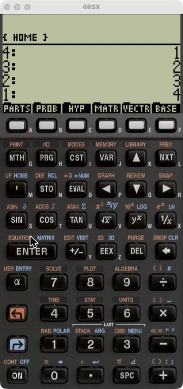
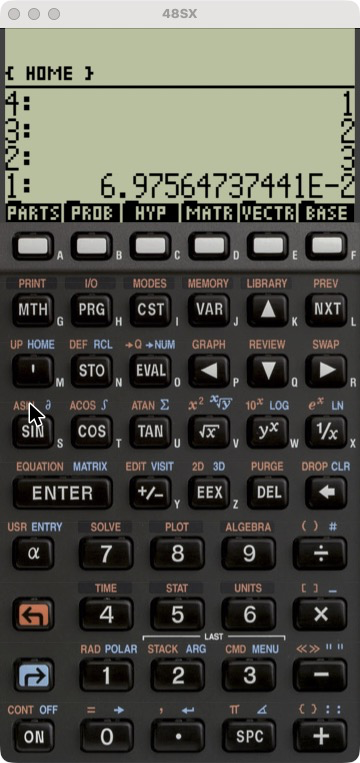

# HP48SX for Mac

A native macOS port of [czodroid/android-48sx](https://github.com/czodroid/android-48sx)
(Olivier Sirol/czo), itself a modified build of droid48 (Arnaud Brochard's
Android port of x48, the 1994 UNIX Saturn-CPU emulator by Eddie C. Dost).
Full RPN/RPL emulation, built as a real Mac app — same dimensions and feel
as the original hardware.

  
  

## Install

Grab the signed, notarized build from
[Releases](https://github.com/my-hash/HP48SX-mac/releases/latest) —
direct link: **[HP48SX.dmg](https://github.com/my-hash/HP48SX-mac/releases/download/v1.0.0/HP48SX.dmg)**.

Open the DMG and drag **48SX** into **Applications**. No warnings, no
right-click workarounds — it's properly code-signed and notarized by Apple.

## Why the HP 48SX

HP released the 48SX in 1993, and three decades later people still hunt
down used units and pay real money for them. A few reasons why:

- **RPN.** Reverse Polish Notation — you push values onto a stack and
  apply operators to them, instead of typing `(` and `)`. No parentheses,
  fewer keystrokes, and once it clicks, it's hard to go back to a normal
  calculator.
- **RPL.** The 48SX is fully programmable in RPL (Reverse Polish Lisp), a
  stack-based language that let a generation of engineering students write
  their own functions, symbolic math tools, and games directly on the
  calculator.
- **Expandable.** The "SX" added two physical card ports for RAM/ROM
  expansion — unusual for a calculator, and part of why it built a real
  hacker/hobbyist following rather than just being a tool you put down
  after the exam.
- **It was the one everyone had.** For a stretch of the '90s and 2000s it
  was the default calculator for engineering and physics students, and
  that shared history is a big part of why it's remembered so fondly —
  communities like [The Museum of HP Calculators](https://www.hpmuseum.org/)
  still actively document and preserve it today.

This project exists so that nostalgia (or curiosity) doesn't require
digging a 30-year-old calculator out of a drawer.

## Credits

- **Eddie C. Dost** — [x48](https://www.gnu.org/software/x48/), the
  original 1994 UNIX Saturn-CPU emulator this entire lineage is built on.
- **Arnaud Brochard** — droid48, the original Android port of x48.
- **Olivier Sirol (czo)** — [android-48sx](https://github.com/czodroid/android-48sx),
  the actively maintained fork this macOS port is based on, byte-for-byte
  where the emulator core is concerned.

## Build from source

    swift run HP48SXMac

### Build a double-clickable .app

    ./Scripts/make-app-bundle.sh
    open build/HP48SXMac.app

### Build a signed, notarized, installable DMG

    ./Scripts/make-dmg.sh

(Needs a Developer ID Application certificate and a `notarytool`
keychain profile named `hp48sx-notary` — see `Scripts/sign-and-notarize.sh`.)

### Tests

    swift test

## License

GPL-3.0 (see `COPYING`). The bundled ROM is free for non-commercial use
per the upstream project. The app icon (`Assets/AppIcon.icns`) is
rasterized from upstream's own `store/img/icon_48sx.svg`, the real
launcher icon the Android app ships.
